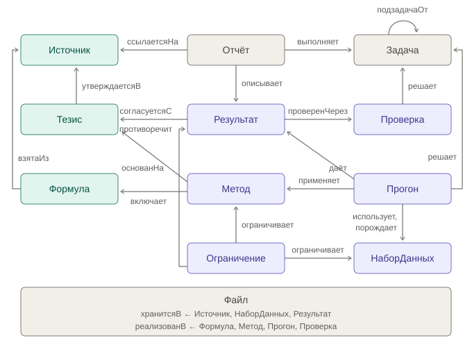

[написано]

# Общая логика работы

Я решил построить работу с агентом AI4Science следующим образом.
Сделаю ему одну задачу-бенчмарк. 
Она будет лежать в папке «tasks». 
Дальше я буду последовательно добавлять в агента «логику», которую мы проходили на разных неделях.

План у меня будет вот такой:
 - неделя 1 - задаём структуру репозитория, формулируем саму задачу и критерий "верификации" решения данной задачи, AGENTS.MD начального уровня
 - неделя 2 - пишем вариант AGENTS.MD
 - неделя 3 - дорабатываю AGENTS.MD, добавляю источник, "перевариваю" его агентом
 - неделя 4 - строю небольшую тестовую онтологию (или систему заметок знаний)
 - неделя 5 - расширяем систему за счёт внешних источников (которые "приземляем" внутрь проекта)

Работа по неделям будет состоять из двух этапов: 
1. Доработка агента
2. Прогон задачи - бенчмарка

В рамках одной "недели" я могу сделать несколько итераций доработки или прогонов, всё это будет отражено в этом отчёте. 
Также буду сравнивать субъективное "качество прогона".
Первое, что нужно сделать - запретить агенту смотреть предыдущие решения (не буду заморачиваться, запрещу в AGENT.md).

# Неделя 1

[написано] AI4Science установлен, doctor проходит без проблем. Я понимаю, что я оставил всё на последний момент, а поэтому мы вместе с claude кодом немного доработали код обвязки AI4Science. Теперь у меня есть второй провайдер модели - OpenRouter, из которого я тягаю deepseek. Я (ну то есть opus 5.5) написал по моей просьбе обвязку так, что лимит в 3М токенов работает и считается если провайдер модели - Яндекс, а для OpenRouter он просто считает сколько токенов потрачено (и сколько денег).

[написано] Создано учебное хранилище, написан начальный AGENT.md

[написано] Поставлена задача с циклом проверки. Это было сложно, в итоге текст самой задачи я писал вместе с claude code. Дальше "агентская" работа будет делаться уже внутри агента

[написано] Попросил агента написать скрипт check_1.py для проверки работы модулятора. Он его написал, в дневнике ещё и написал, что он не делает. Попрошу его доработать его, чтобы проверял работу модулятора подробнее

[написано] DeepSeek с опенроутера оказался импостером. Я не знаю почему, но модель 4.1 flash с OR в нашем агенте повела себя отвратительно.

Она не сообщает свои действия (как это делает дипсик от яндекса), а молча вызывает тулы. Несколько раз она просто выдала warning что достигла output-token limit и прерывала ответ. Начал с claude code препарировать проблему, он сказал, что это потому, что у яндекса нет
внутреннего thinking, а у deepseek с OR он есть и его надо выключить.

Ха! После выключения пару простых запросов обработались хорошо. Зато потом на просьбе улучшить скрипт check_1.py она вошла в цикл, вызвала ОДНУ И ТУ ЖЕ КОМАНДУ 120 РАЗ и сожгла на этом примерно 2 млн. токенов. Повторный вызов воспроизвёл проблему (но тут я уже следил за тем, что он творит и прервал вакханалию раньше).

В общем вместо того, чтобы дорабатывать агента полночи воевал с дипсиком опенроутера.

[написано] Claude напомнил мне, что openrouter - это ретранслятор и на самом деле deepseek он отдаёт от совершенно
разных провайдеров и не факт, что работа будет воспроизводимой (у них даже квантизация может меняться).
Поэтому я принял решение добавить в своего гуся ключ DeepSeek из API самих DeepSeek. Посмотрим, как будет работать 
китайская LLM в таком режиме...

[написано] Решил переписать task_1.md и удалить checks. Идея будет такая, что код проверки 
агент должен будет написать сам, а я смогу проверить его независимо + проверяю отчёт report.md
В текущем варианте всё-таки текст задачи был слишком подробный, был частично порождён более 
умным агентом и это сказывалось на работе.
Также как будто при текущих формулировках ограничены возможности улучшения работы агента при 
создании и пополнении базы знаний.
Удалил конкретные советы по функциям и способам работы с волнами. Потом перезапущу task_1.md

[написано] Хитрый дипсик подсматривал в дневник и несмотря на то, что задачу я сформулировал 
более общо он всё равно сделал тоже самое, что в предыдущей итерации и в итоге воспроизвёл результат.

[написано] В общем агент выполнил задачу 1 на первой неделе, будем брать это как точку отсчёта. 
DeepSeek получается нормально работает у Яндекса и у самого DeepSeek, от OpenRouter получается шляпа.

# Неделя 2

[написано] На второй неделе я доработал AGENT.md по мотивам лекции. Добавил цель проекта и образ результата, явный критерий готовности: прогон не считается законченным, пока команда проверки из задачи не прошла. Ещё добавил карту проекта (INDEX.md), границы работы агента, раздел запретов, протокол работы, правила ведения дневника и условия остановки (три неудачи одряд, бюджет токенов). Сравнения работы "без AGENT.md" и "с AGENT.md" по сути не было: на первой неделе у агента уже был AGENT.md, только менее 
подробный.

[написано] Сравнение прогонов t1-w1-r1 и t1-w2-r1. Второй прогон формально решён «с нуля», но независимым его назвать нельзя: структура первого решения просочилась через checks/checks.py и INDEX.md. Проверку писал агент первой недели, и она задаёт формат разметки, имена наборов и каталог прогона. Агент заметил, что проверка жёстко указывает на каталог прошлого прогона, и не стал её править, а написал обёртку. Это прямой эффект нового раздела о критерии готовности. Папка прогона стала аккуратнее, появилась отдельная сверка рисунков. 

При этом качество решения заметно не улучшилось, а часть инструкций агент проигнорировал: например, не встроил рисунки в отчёт, хотя задача этого требует. Ещё любопытно, что два прогона по-разному измерили одни и те же записи: задержку стопы и отношение амплитуд стопа/рука. 

# Неделя 3 и Неделя 4

[написано] Мне кажется, что сначала логичнее будет построить онтологию, а потом используя эту онтологию строить граф знаний и переваривать разные источники. Поэтому я сначала соберу онтологию (небольшую), а потом, используя её буду собирать систему знаний проекта.

[написано] Онтологию проекта я собирал не через агента курса, а в диалоге с Claude Code; итоговый ontology.yaml проверен и принят мной, об этом пометка в его шапке. Причина: я не хотел засорять агента курса дополнительными шаблонами, а с claude code получилось использовать лекционные материалы как затравку для готовой онтологии. В онтологии 15 классов, 19 отношений и 13 правил. У неё две цели: вести задачи так же, как в шаблоне лекции (Задача, status, подзадачаОт, правила о выполненных задачах и разделе «Итог»), и дисциплинировать работу агента с литературой.

[написано] Утверждение из статьи (Тезис) отделено от утверждения, полученного в проекте (Результат): так агент не выдаёт свои числа за данные из литературы. Каждая Формула связана и с источником (взятаИз), и с файлом кода (реализованВ): формула без источника по правилу П3 сразу видна как придуманная агентом. Класс Эксперимент из шаблона заменён на Прогон: в моём проекте задачу закрывает прогон runs/tN-wX-rY/.

[написано] Заметки классов в ontology/ (15 штук) строит скрипт tools/build_class_notes.py из ontology.yaml; режим --check сверяет заметки со схемой и проходит. Схема связей классов:

[написано] Чтобы внедрить онтологию, пришлось поменять структуру. Постановка задачи-бенчмарка переехала из tasks/ в benchmark/: по механике недели 4 папку tasks/ ведёт агент (задачи, статусы, итоги), а постановка бенчмарка заморожена и агенту запрещена — в одной папке эти две роли конфликтовали. Источники разделены на два места: papers/ — исходные PDF под .gitignore, library/ — переваренные статьи в git. Скрипт генерации заметок классов вынесен в tools/, чтобы в графе Obsidian среди классов не было лишнего узла.

