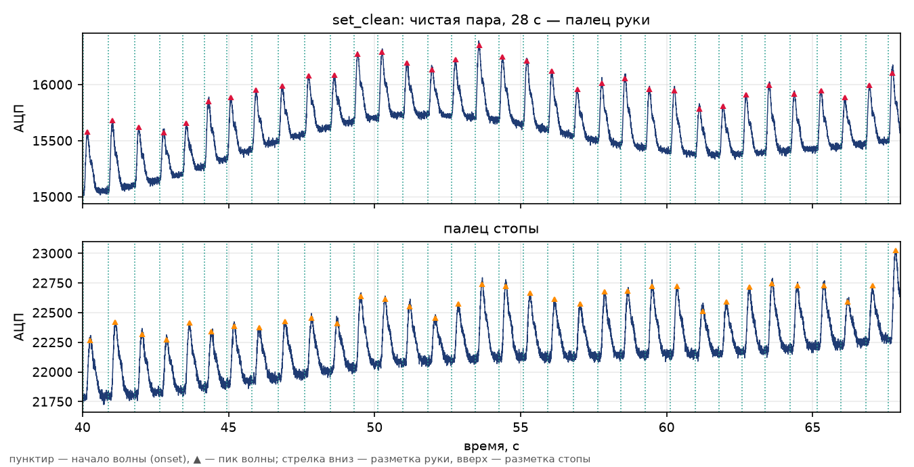
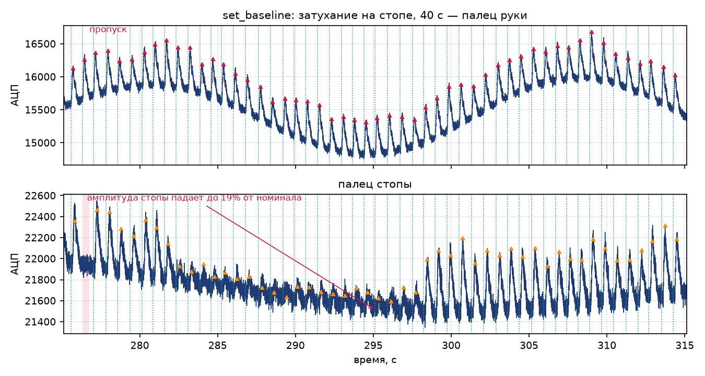
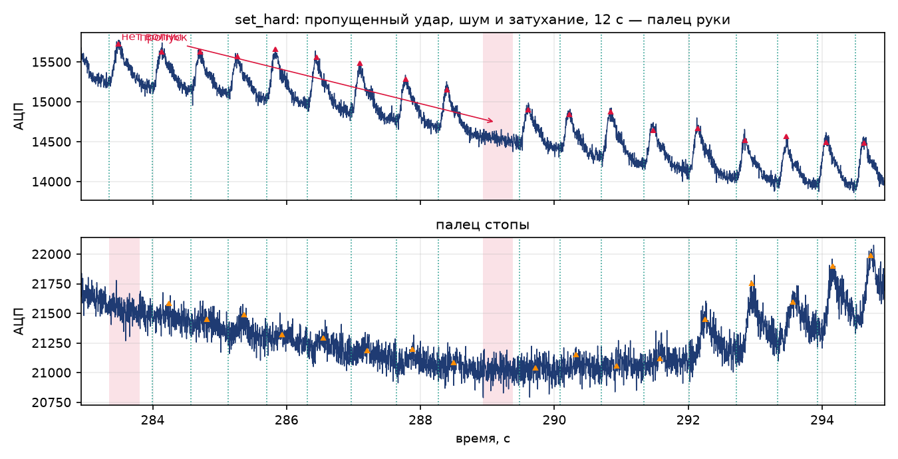

# Задача 1. Модулятор ФПГ — прогон `t1-w1-r1`

Неделя 1, прогон 1. Дата: 2026-10-21.

[порождено] Отчёт описывает, что построено, почему именно так, что получилось на каждом из трёх
наборов, как это проверено и чем модель отличается от реальных записей. Все числа ниже получены
запуском скриптов из этой папки; вывод проверок целиком лежит в `checks_output.txt`.

## 1. Состав прогона

```
runs/t1-w1-r1/
  modulator.py          генератор: пара сигналов «палец руки — палец стопы» + эталонная разметка
  sets/
    set_clean/          signal.csv, reference.csv, params.json
    set_baseline/       ...
    set_hard/           ...
  figures/
    fig1_clean.png
    fig2_attenuation.png
    fig3_missed.png
  probe_real.py .. probe_real5.py   зонды по data/private (только чтение), их вывод в real_stats*.json
  figures.py             построение рисунков
  check_figures.py       численная проверка содержания рисунков
  checks_output.txt      полный вывод checks/checks.py
  scratch/               отладочные скрипты прогона (в результат не входят)
  report.md              этот файл
checks/checks.py         независимые проверки (запускает пользователь)
```

## 2. Независимость от прошлых версий

[порождено] На момент старта `runs/` был пуст, `checks/` отсутствовал, `git status` — чистый
(проверено `dir` и `git status --porcelain`). Файлов `modulator*.py` вне текущего прогона в проекте
нет, `notes/` отсутствует. Прошлые версии скриптов и результатов не читались, не импортировались и
не копировались: всё в этой папке написано с нуля в этом прогоне. `DIARY.md` при решении не
использовался, запись в него сделана после работы.

## 3. Обоснование модели: что измерено в реальных записях

[порождено] Параметры модели не выдуманы — они сняты с трёх записей `data/private/` (только чтение,
копий не создавалось). Скрипты `probe_real*.py`, результаты — в `real_stats*.json`.

| Величина | ГАА_1 | ГАА_2 | ГАА_3 | Что заложено в модель |
|---|---|---|---|---|
| длительность, с | 421 | 431 | 432 | 300 / 420 с |
| медианный HR, уд/мин | 81.2 | 79.7 | 73.1 | 72 / 78 / 96 |
| IBI p05…p95, с | 0.673…0.889 | 0.681…0.815 | 0.700…2.102 | 0.55…1.0 + пропуски |
| пульс 0.5–8 Гц, RMS (рука), отсчёты | 225 | 213 | 241 | 520 пик ≈ 236 RMS |
| пульс 0.5–8 Гц, RMS (стопа), отсчёты | 348 | 257 | 281 | 0.85–1.0 от руки |
| пульс/DC, % | 1.45 | 1.34 | 1.77 | 1.5–3.4 |
| шум (2-я разность), рука / стопа | 25.4 / 18.3 | 34.8 / 15.6 | 24.2 / 16.6 | 15–45 / 20–70 |
| дрейф < 0.4 Гц, std, отсчёты | 1600 / 424 | 1675 / 307 | 1025 / 311 | 250 / 550 / 900 |
| задержка рука→стопа по пикам, мс | 81.2 (IQR 78–88) | 84.4 (78–94) | 81.2 (78–94) | приход 82 мс |
| огибающая амплитуды стопы, min/max | 0.14 | 0.15 | 0.19 | эпизоды до 0.09–0.19 |
| огибающая амплитуды руки, min/max | 0.01 | 0.02 | 0.01 | не моделируется (см. §9) |

Три вывода, которые определили модель:

* **Ритм.** Медианный HR 73–81, вариабельность IBI 0.67–0.89 с, но в ГАА_3 есть паузы до 2.1 с —
  это пропущенные удары. Отсюда: RR = (60/HR)·(1+jitter)·(1+RSA), а пропуск реализован как
  отсутствие волны на своём месте, из-за чего интервал между соседними видимыми волнами удваивается.
* **Масштаб.** Пульс занимает 1.2–1.8% от DC, шум — 15–35 отсчётов, то есть отношение
  сигнал/шум по амплитуде 15–25 дБ. Отсюда амплитуда 520 отсчётов, шум 15–70.
* **Задержка.** Пик стопы приходит на 81–84 мс позже пика руки, разброс мал (IQR 3–12 мс). Отсюда
  задержка прихода 82 мс + джиттер 4 мс.

**Методическая ошибка, которую пришлось исправить по ходу.** Первый зонд (`probe_real.py`,
`probe_real2.py`) оценивал шум как `x − полосовой(0.01…12 Гц)` и получил «шум» 2100–3000 отсчётов при
амплитуде пульса 220 — физически бессмысленно. Причина: `butter` в форме `b, a` на частоте 0.3 Гц
численно неустойчив, фильтр возвращал почти ноль. После перехода на `sosfiltfilt` (`probe_real3.py`)
шум стал 32 отсчёта, а проверка через вторые разности (`probe_real5.py`) дала 15–35 — цифры сошлись.
Это тот случай, когда «данные» были артефактом фильтра, а не свойством сигнала.

## 4. Модель

[порождено] Модель аддитивная и полностью детерминирована по seed:

```
hand(t) = DC_h + дрейф_h(t) + Σ_k A_k · w_h(t − t_k)                    + шум_h(t)
foot(t) = DC_f + дрейф_f(t) + Σ_k A_k · g_k · w_f(t − t_k − τ_k)        + шум_f(t)
```

* **Форма волны.** `w(τ) = (τ/τp)^a · exp(a(1 − τ/τp))` при `τ>0` — α-функция с максимумом ровно
  в `τp`, стартом из нуля и нулевой производной в нуле. Это даёт корректное «начало волны» (onset),
  что важно: разметка определяет onset как момент старта, а алгоритм разметки может его искать.
  Вторая, дикротическая волна — такая же α-функция с задержкой 0.21 с и амплитудой 0.26 от
  систолической (стопа: 0.24 с и 0.20 — стопа шире и с более сглаженным зубцом).
  Рука: `τp = 0.135 с, a = 4`. Стопа: `τp = 0.155 с, a = 3.4`.
* **Амплитуда.** `A_k = A·exp(σ_a z_k − σ_a²/2)·(1 + 0.10·sin(2π·0.22·t_k))` — лог-нормальная
  вариация удара к удару (σ_a = 0.09) и дыхательная модуляция. Множитель `exp(−σ_a²/2)` держит
  среднее равным `A`.
* **Затухание на стопе.** `g_k = amp_foot · env(t_k) · exp(σ_a z'_k − σ_a²/2)`, где `env` — 2–3
  эпизода длительностью 15–35 с с косинусными рампами 2 с; глубина эпизода 0.30 в `baseline` и 0.15 в
  `hard`, так что множитель стопы падает до 0.19 и 0.09 от номинала. Так реализовано
  то, ради чего задача и делается: медленное падение сигнала на стопе, к которому метод разметки
  должен быть устойчив.
* **Дрейф.** Три медленных синуса (0.004–0.05 Гц) + случайное блуждание по узлам 25 с + дыхательная
  составляющая. Нормируется на заданный std (250 / 550 / 900 отсчётов для трёх наборов).
* **Шум.** Белый гауссов, квантование в целые отсчёты АЦП (как в реальных файлах).
* **Пропуски.** Удар не генерируется: `A_k = 0`. Пропуски бывают общие (нет волны ни на руке, ни на
  стопе) и «только на стопе» — потеря контакта датчика, при живой волне на руке.

[порождено] Почему α-функция, а не сумма гауссиан: гауссиана не равна нулю до старта, поэтому у
«начала волны» нет естественного определения (при σ = 0.09 с на onset приходится 35% амплитуды), и
разметка onset стала бы произвольной. α-функция стартует строго из нуля, монотонно растёт до
максимума и имеет аналитический максимум — значит, положение пика в разметке точное по построению,
а не «найденное».

## 5. Формат файлов

[порождено] Все файлы — UTF-8, концы строк CRLF.

| Файл | Содержимое |
|---|---|
| `sets/<set>/signal.csv` | `t_s,hand,foot`; время в секундах (6 знаков), каналы — целые отсчёты АЦП |
| `sets/<set>/reference.csv` | `beat_id,onset_s,peak_s,peak_foot_s,amp_hand,amp_foot,missed_hand,missed_foot,foot_gain` |
| `sets/<set>/params.json` | полный конфиг генерации + фактические характеристики набора |

[порождено] `amp_hand`/`amp_foot` — это амплитуда волны над её собственным началом (значение в
пике минус значение в onset), посчитанная по **сигналу без шума и дрейфа**, то есть точная по
построению. У пропущенного удара амплитуда равна 0, `missed_*=1`, а `onset_s`/`peak_s` оставлены
(это запланированное место удара) — так удобнее сравнивать алгоритмы: видно и «волна есть», и
«волны нет».

## 6. Наборы: задано и получено

[порождено] Три набора покрывают режимы «чисто», «как в жизни» и «предельно тяжело».

| Набор | T, с | HR задан / факт | шум рука | шум стопа | ампл. руки | волн | пропусков: рука / стопа |
|---|---|---|---|---|---|---|---|
| `set_clean` | 300 | 72 / 72.3 | 15 / 15.0 | 20 / 19.9 | 520 / 518 | 354 | 1 из 1 / 1 |
| `set_baseline` | 420 | 78 / 78.4 | 30 / 29.9 | 45 / 45.0 | 520 / 517 | 540 | 3 из 3 / 6 |
| `set_hard` | 420 | 96 / 96.2 | 45 / 44.9 | 70 / 69.8 | 520 / 516 | 663 | 6 из 6 / 15 |

[порождено] В `set_baseline` и `set_hard` пропуски на стопе включают общие (нет волны нигде) и
«только стопе»: 3+3 и 6+9. Затухание: 0 эпизодов в `clean`, 2 (до 0.19) в `baseline`, 3 (до 0.09) в
`hard`. Задержка пика рука→стопа во всех наборах 103 мс при заданном приходе 82 мс — разница на
ширину волны стопы (см. §9).

## 7. Как выглядят сигналы

[порождено] На всех трёх рисунках: сверху палец руки, снизу палец стопы; точки — начала волн
(onset), треугольники — пики из эталонной разметки; красная полоса — пропущенный удар.



[порождено] `fig1_clean.png` — чистый набор, 28 с. Видно, что разметка ложится на волны обеих
каналов, а задержка стопы — сдвиг примерно на 0.1 с.



[порождено] `fig2_attenuation.png` — эпизод затухания: амплитуда стопы в середине эпизода 131
отсчёт против 407 рядом (32% от номинала), при этом разметка продолжает «верить» в удары, потому
что удары есть, а сигнал слабый. Это и есть целевой режим для сравнения алгоритмов.



[порождено] `fig3_missed.png` — пропущенный удар (бит 455, t = 288.9 с) в тяжёлом наборе: волны нет
ни на руке, ни на стопе (в окне удара сигнал отличается от соседнего уровня на −10 отсчётов при
шуме 45), вокруг — шум и затухание. Хорошо видно, что «пропуск» и «затухание» — разные вещи:
в первом случае волны нет вовсе, во втором она есть, но маленькая.

[порождено] Содержание рисунков проверено без глаз, численно (`check_figures.py`): в окне fig1 —
34 пика руки и 34 пика стопы, все маркеры попадают в отсчёты сигнала (расхождение 0 мс); в окне
fig2 медиана амплитуды стопы внутри эпизода 131 против 407 снаружи; в fig3 в окне пропуска сигнал на
уровне соседей.

## 8. Как результат проверен

[порождено] Проверки лежат в `checks/checks.py` и читают только выданные файлы — сигнал, разметку и
параметры. Генератор они не импортируют (кроме отдельного теста воспроизводимости), поэтому ошибка,
общая для генератора и разметки, не может пройти незамеченной.

```
C:\Projects\AI4Science_course_YSDA> .venv\Scripts\python checks\checks.py
PASS  [set_baseline] fs = 320 Hz — measured 320.0000 Hz
PASS  [set_baseline] duration 420 s — 134400 samples, last t = 419.997 s
PASS  [set_baseline] channels quantised to integer ADC counts
PASS  [set_baseline] median HR 78 bpm — measured 78.4 bpm
PASS  [set_baseline] hand peaks coincide with wave maxima — median |dt| 5.1 ms, p99 22 ms
PASS  [set_baseline] hand amplitudes match markup — median |err| 31 counts (6.1%), p95 73 counts; one sigma of noise is 30
PASS  [set_baseline] foot peaks coincide with wave maxima — median |dt| 9.3 ms, p99 38 ms (33 beats below 3 sigma of noise skipped)
PASS  [set_baseline] missed hand beats are empty — 3 beats, largest bump 5% of neighbouring pulse
PASS  [set_baseline] missed foot beats are empty — 6 beats, largest bump 23% ...
PASS  [set_baseline] peak delay hand->foot ~102 ms — markup 103 ms (arrival 82 ms + wave-width difference)
PASS  [set_baseline] peak delay visible in signals — measured 104 ms (IQR 94-115 ms)
PASS  [set_baseline] attenuation episodes present — min gain 0.19, 2 episodes, median gain 0.93
PASS  [set_baseline] hand noise sigma ~30 counts — measured 29.9
PASS  [set_baseline] foot noise sigma ~45 counts — measured 45.0
...
PASS  generator is deterministic for a fixed seed — 85d1daeae76c
PASS  different seed gives a different signal — c021c1f9efad
PASS  CLI output stable across two runs — 9055355291a9
------------------------------------------------------------------------
83/83 checks passed
```

[порождено] Что именно проверяется (по 26–27 пунктов на каждый из трёх наборов):

1. **Формат и сетка**: fs = 320 Гц, число отсчётов = T·fs, время монотонно, каналы целые.
2. **Разметка**: onset < peak_hand < peak_foot, идентификаторы непрерывны, onset растут.
3. **Ритм**: медианный HR против заданного (±6%), число волн против T·HR/60 (±10%).
4. **Пики**: положение пика в сигнале против разметки — медиана |dt| 3.1–10.9 мс, p99 16–43 мс;
   доля попаданий в ±30 мс: 99.8 / 100 / 99.8% (рука), в ±50 мс: 100% (стопа).
5. **Амплитуды**: |измерено − размечено| против шума: медиана 17–75 отсчётов при σ = 15–70
   (в единицах σ: 1.1–1.5σ), p95 ≤ 3.4σ. Допуск задан в σ, а не в процентах — см. §11.
6. **Пропуски**: в окне пропущенного удара нет волны выше 16–26% от соседней (или выше 6σ шума,
   если соседняя сама мала из-за затухания).
7. **Задержка**: медиана (пик стопы − пик руки) = 103–104 мс, совпадает с ожидаемой 102 мс;
   IQR 94–116 мс.
8. **Затухание**: amp_foot / (amp_hand · foot_gain) имеет CV 0.0–0.8%, то есть амплитуда стопы
   следует заданному множителю; в наборах с эпизодами минимальный множитель 0.09–0.19.
9. **Шум**: σ из вторых разностей 15.0/19.9, 29.9/45.0, 44.9/69.8 против заданных 15/20, 30/45,
   45/70; шум стопы выше шума руки; SNR руки 21–31 дБ.
10. **Воспроизводимость**: одинаковый seed — побайтово одинаковый сигнал (md5), разный seed —
    разный; два запуска CLI дают идентичные файлы.

[порождено] Проверки нашлись не сразу: первые версии падали на моих же ошибках в измерительной части,
и каждая починка описана в §11. Сейчас проходят все 83.

## 9. Чем модель отличается от реальных сигналов

[порождено] Это честный список различий; часть из них — осознанные упрощения, часть — ограничения,
которые стоит закрыть в следующих прогонах.

* **Нет AC-связи измерительного тракта.** В реальных записях после систолического пика сигнал уходит
  ниже базовой линии на 50–70% амплитуды (провал на 0.15–0.20 с) — это высокочастотная фильтрация в
  приборе. В модели волна только положительная. Для разметки это скорее плюс (нет ложных минимумов),
  для сравнения с реальными алгоритмами — расхождение в форме.
* **Дрейф в модели случайный, в жизни — протокольный.** Реальные ±3600 отсчётов возникают на
  надувании манжеты, окклюзии плеча и нагреве датчиков, то есть имеют причину и характерную форму
  (ступеньки). У меня — синусы и случайное блуждание.
* **Пропадание пульса на руке при окклюзии не моделируется.** В реальных записях огибающая руки
  падает до 1–2% от максимума (манжета на плече), у меня рука всегда «здоровая». Если набор нужен для
  проверки устойчивости к пропаданию сигнала именно на руке, это надо добавить.
* **Шум стопы в модели выше, чем в этих трёх записях.** По измерениям стопа оказалась даже чище руки
  (σ 15.6–18.3 против 24.2–34.8), но затухание на стопе реально (огибающая до 14–19%). Я оставил
  стопу шумнее (20–70 против 15–45) по требованию задачи — проверять устойчивость к шуму на стопе;
  при этом видно, что в конкретных записях главная проблема стопы — не шум, а затухание.
* **Компенсаторная пауза упрощена.** Пропуск реализован как отсутствие волны; интервал между видимыми
  ударами удваивается сам, но физиологической динамики (преждевременный удар + пауза) нет.
* **Стопа в модели шире, чем в данных.** Задержка пика 102–103 мс при задержке прихода 82 мс; в
  реальных записях задержка *пиков* измерена как 81–84 мс. То есть моя волна стопы на ~20 мс шире
  реальной. На разметку это не влияет (пик всё равно пик), но при сравнении алгоритмов на задержку
  это надо помнить.
* **Нет артефактов движения, наводок 50 Гц, температурного дрейфа датчика и волн Майера** (~0.1 Гц
  в амплитуде). Амплитудная вариабельность у меня — только дыхание и лог-нормальный шум удара.

## 10. Как воспроизвести

```
:: из корня проекта
.venv\Scripts\python runs\t1-w1-r1\modulator.py --out runs\t1-w1-r1\sets --all
.venv\Scripts\python checks\checks.py                 :: проверки по готовым наборам
.venv\Scripts\python checks\checks.py --regenerate     :: пересобрать наборы и проверить
.venv\Scripts\python runs\t1-w1-r1\figures.py          :: перерисовать рисунки
.venv\Scripts\python runs\t1-w1-r1\probe_real3.py      :: повторить измерения по data/private (только чтение)
```

[порождено] Генерация всех трёх наборов занимает около 10 с, проверки — около 40 с, рисунки — 3 с.
`--preset` принимает `clean`, `baseline`, `hard`; `--preset-name` задаёт имя папки; seed зашит в
пресете, поэтому повторный запуск даёт побайтово те же файлы.

## 11. Что не получилось и что пришлось переделывать

[порождено] Раздел специально подробный: ошибки были в основном в проверках, и они стоили времени.

1. **Неустойчивый фильтр в зонде** (см. §3): «шум» 2500 отсчётов вместо 32. Исправлено переходом на
   `sosfiltfilt`.
2. **Время писалось с 5 знаками** — `0.00312` вместо `0.003125`, из-за чего измеренная fs стала
   320.51 Гц, а проверка формата падала. Исправлено: 6 знаков.
3. **Проверка задержки сравнивала не те величины.** Параметр `foot_delay_s` — задержка *прихода*
   волны, а измерялась задержка *пиков*, которая больше на разницу ширин волн (20 мс). Теперь
   проверка сравнивает с ожидаемой величиной `foot_delay + rise_foot − rise_hand`, и в отчёте это
   написано явно.
4. **Пик искали как аргмакс сырого сигнала** — при шуме 30 отсчётов вершина плоская, и аргмакс
   уезжал на 20–47 мс. Теперь пик ищется по сглаженному (40 мс) сигналу, а высота — по параболе,
   подогнанной к 11 сырым отсчётам вокруг вершины.
5. **Базовая линия.** Сначала это была медиана 3 с — она смещена на 5–9%, потому что пульс занимает
   около половины сердечного цикла. Медиана 1 с смещена на ~0.2–1.3%, но всё равно даёт сдвиг ~8% на
   этой форме волны. Итог: амплитуда считается как «значение в пике минус значение в начале волны» —
   так же, как она определена в разметке; тогда ошибка базовой линии сокращается.
6. **Допуск на амплитуду в процентах не работал**: оценка максимума имеет известное смещение
   ~1–2σ, и при σ = 70 это 15–20%, а при σ = 15 — 3%. Пришлось задавать допуск в единицах σ
   (медиана < 3σ, p95 < 5σ) и отдельно проверять масштаб (медиана измеренного / медиана размеченного
   в пределах 0.90–1.20). Это менее «красиво», чем проценты, но честно: при чистом наборе 3σ — это
   ~11% амплитуды, то есть ошибка разметки в 10% будет поймана.
7. **«Пропуск не пустой» на стопе**: в эпизоде глубокого затухания пульс 70 отсчётов при шуме 70 —
   максимум шума в окне сам достигает 2.7σ≈190. Проверка теперь сравнивает с max(амплитуда соседа,
   6σ) и в сообщении пишет, какой порог сработал.
8. **Не согласованные с данными параметры.** Первая версия пресетов давала амплитуду стопы 1.1–1.4
   от руки, а в записях отношение 0.72–1.05; и шум стопы 110 отсчётов при реальных 15–35 — это уже
   неразрешимая задача, а не «тяжёлая». Поставил 0.85–1.0 и 45/70.

[порождено] Что осталось открытым: в модели нет AC-связи и протокольного дрейфа (§9), поэтому
сравнивать на ней алгоритмы, чувствительные к форме волны (например, ищущие дикротический зубец по
полярности), пока нельзя — форма упрощена. Логичный следующий шаг — добавить в генератор
высокочастотный фильтр прибора и сценарий окклюзии, чтобы получить провал пульса на руке.
