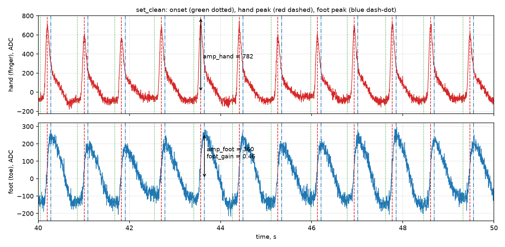
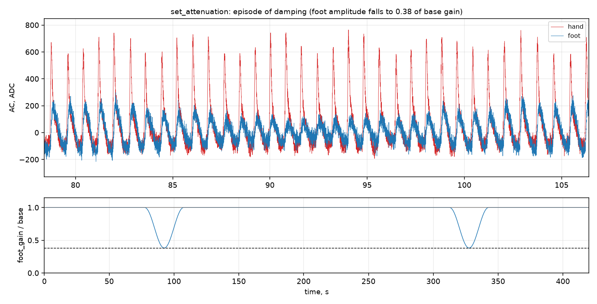
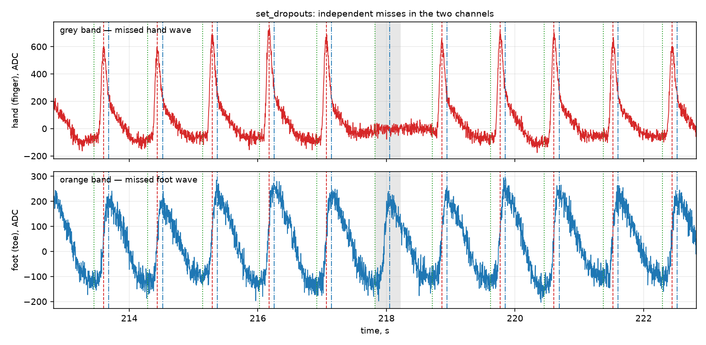
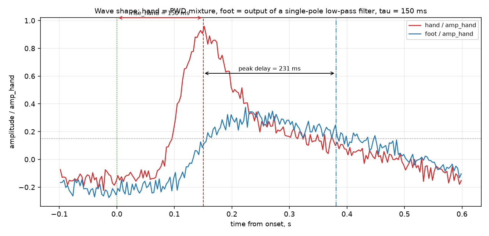

# T1, неделя 4, прогон 1 — модулятор синтетических ФПГ-пар

[порождено] Отчёт о прогоне `runs/t1-w4-r1`: что построено, почему именно так, что получилось на четырёх наборах, как это проверено и чем модель отличается от реальных записей. Код: `modulator.py` (генератор), `figures.py` (рисунки), `check_figures.py` (численная сверка рисунков), `probe_real.py` (замеры по `data/private/`), `scratch/probe_delay_sign.py` (проверка знака задержки вторым способом).

## 1. Что построено

[порождено] `modulator.py` строит пару каналов «палец руки — палец стопы» и файл эталонной разметки; положение и высота каждой волны известны по построению, а не находятся по сигналу. Наборы: `sets/set_clean`, `sets/set_drift_noise`, `sets/set_dropouts`, `sets/set_attenuation`. Каждый набор — три файла по контракту: `signal.csv` (`t,hand,foot`, 320 Гц, целые отсчёты АЦП), `reference.csv` (9 столбцов), `params.json`.

[порождено] Модель не придумана заново: она собрана из знаний, которые уже лежат в проекте. Для канала $c$:

$$x_c(t)=\mathrm{DC}_c+d_c(t)+\sum_k g_{c,k}A_{c,k}s_c(t-\text{onset}_k)+n_c(t)$$

[порождено] Основания по частям:

| Блок модели | Как сделано | На чём основано |
|---|---|---|
| Форма волны руки $s_{\text{hand}}$ | model-based PWD: логнормальное систолическое ядро ($\sigma=0.26$) плюс отражённая диастолическая компонента ($0.28$ от ядра, на $1.85$ времени подъёма) | `notes/Тезис — PWD раскладывает волну на гауссовы и логнормальные компоненты` |
| Форма волны стопы $s_{\text{foot}}$ | выход однополюсного ФНЧ с временем константы $\tau=0.15$ с от той же волны | `notes/Формула — однополюсный фильтр затухания`, `notes/Тезис — Затухание описывается однополюсным ФНЧ` |
| Затухание ↔ задержка ↔ время подъёма | считаются из одного $\tau$, а не задаются независимо | `notes/Тезис — На стопе пульс затухает и запаздывает` |
| Дыхательная модуляция $A_{c,k}$ | $A_k=\text{amp}\,(1+m\sin(2\pi t_k/T_{\text{resp}}+\varphi))$, $m=0.10\ldots0.15$, $T_{\text{resp}}=4.2$ с, объявлена в `params.json` | `notes/Метод — модель волны следующей версии`, п. 3 |
| Дрейф $d_c(t)$ | сумма пяти синусоид 0.017–0.31 Гц (ниже 0.5 Гц), СКО уровня 45 % объявленного | п. 5 контракта: дрейф медленный и меньше амплитуды волны |
| Шум $n_c(t)$ | независимый по каналам белый шум, СКО по каналу | `data/signals.md` (отсчёты АЦП), `notes/Метод — контракт синтетического набора T1` |
| Пропуски | независимые маски по каналам; пропуск руки не гасит волну стопы, пропуск стопы не меняет руку | `notes/Тезис — Морфологию задают статические и динамические факторы` (разделение причин), п. 4 модели |
| Квантование | `round` в целые 0…65535, без насыщения | `data/signals.md`, контракт |

[порождено] Разметка не измеряется по сигналу, а выводится из формы:

- `peak_s = onset_s + rise_hand_s` — аналитический максимум $s_{\text{hand}}$ (форма нормирована так, что её максимум равен 1 и стоит ровно в `rise_hand_s`);
- `peak_foot_s = onset_s + T_{\text{peak}}(\tau)$`, где $T_{\text{peak}}$ — момент максимума выхода ФНЧ;
- `foot_delay_s = \theta_{15}^{\text{foot}}-\theta_{15}^{\text{hand}}` — сдвиг момента достижения 15 % амплитуды, измеренного одинаковым правилом на обоих каналах;
- `rise_foot_s = T_{\text{peak}} - foot\_delay\_s$.

[порождено] Почему задержка определена именно так. Наивный вариант «`foot_delay_s` = групповое запаздывание $\tau$» ломает требование «стопа поднимается медленнее руки»: тогда `rise_foot_s` выходит меньше `rise_hand_s`, потому что часть задержки уже учтена в $\tau$. Определение через общую для двух каналов точку 15 % делает все четыре объявленные величины согласованными по построению, а не подогнанными: задержка, время подъёма и затухание остаются функциями одного $\tau$.

## 2. Что получилось на прогонах: заданное и фактическое

[порождено] Таблица собрана из лога приёмки `runs/t1-w4-r1/checks_output.txt` (фактические значения — то, что измеряет `checks/check_1.py` по файлам набора).

| Набор | Задано | Фактически |
|---|---|---|
| `set_clean` | 300 с, 72 уд/мин, 358 ударов, шум 22/22, дрейф 140/120, пропусков 0, затуханий 0 | 71.7 уд/мин, CV IBI 3.7 % при 3.5 %, шум 22.0/22.1, СКО уровня 64.4/61.0, задержка пика стопы 86 мс (объявлено 81), CV `foot_gain` 5.3 % |
| `set_drift_noise` | 420 с, 78 уд/мин, 545 ударов, шум 28/34, дрейф 260/220, усиление 800 | 78.0 уд/мин, шум 27.9/33.9, СКО уровня 127.3/111.7, задержка 87 мс, CV `foot_gain` 12.3 %, корреляция амплитуды стопы с модуляцией 0.76 |
| `set_dropouts` | 360 с, 68 уд/мин, 407 ударов, 6 пропусков руки, 4 стопы | 68.1 уд/мин, из 407 ударов измерено 401 по руке и 397 по стопе (ровно 6 и 10 = 6+4), задержка 84 мс |
| `set_attenuation` | 420 с, 74 уд/мин, 518 ударов, 2 эпизода, глубина 0.38 | 74.2 уд/мин, наблюдаемых провалов 2, минимум `foot_gain` 0.380 от базового, задержка 89 мс |

[порождено] Общие числа по прогону: 4 набора, 1828 ударов, 208 проверок, время приёмки 10.4 с. Ошибка времени пика руки — медиана 2.6–2.7 мс, p99 5–6 мс; стопы — медиана 9.5–12.8 мс, p99 46–59 мс (допуск: медиана 15 мс, p99 60 мс). Ошибка амплитуды руки 4.0–4.7 % от амплитуды при шуме 22–28 отсчётов, стопы 5.3–10.3 %. Прирост времени подъёма стопы 56–58 мс при объявленных 57 мс.

[порождено] Систематическое смещение. Измеренная задержка пика стопы на 3–8 мс больше объявленной (86–89 против 81 мс) во всех наборах и в одну сторону. Объявленная величина — аналитический максимум ФНЧ-выхода, измеренная — argmax сигнала, сглаженного 40 мс, минус медианный уровень. У стопы вершина плоская, поэтому оценка смещается вправо. Смещение меньше допуска (25 мс), но оно систематическое, и его нужно помнить при переходе к реальным записям.

## 3. Как выглядят сигналы

[порождено] Рисунок 1 — чистый набор, 10 с: зелёные пунктиры — начала волн (`onset_s`), красные штрихи — пики руки (`peak_s`), синие штрихпунктиры — пики стопы (`peak_foot_s`). Стрелки показывают, что `amp_hand` и `amp_foot` в разметке — это высоты волн над уровнем начала, а не значения сигнала в пике.



[порождено] Рисунок 2 — эпизод затухания: на верхней панели видно, как амплитуда стопы падает, а амплитуда руки в том же интервале не меняется; на нижней — объявленный `foot_gain` по ударам, нормированный на базовое усиление, и линия объявленной глубины 0.38.



[порождено] Рисунок 3 — пропуски: серая полоса — цикл без волны руки, оранжевая — без волны стопы. Видно, что пропуски независимы: в сером цикле волна стопы на месте, в оранжевом — волна руки.



[порождено] Рисунок 4 — одна волна в масштабе амплитуды руки: форма руки (PWD-смесь) и стопы (выход ФНЧ), уровень 15 % и обе точки пика. Видно, что стопа ниже, шире и позже — три следствия одного $\tau$.



## 4. Как результат проверен

[порождено] Приёмка (критерий готовности задачи):

```text
.venv\Scripts\python checks\check_1.py --run runs/t1-w4-r1 --regenerate
```

[порождено] Итог: `211/211 проверок пройдено; наборов 4, ударов 1828, 8.6 с`, код возврата 0. До появления файла отчёта было 207/208 — единственным непройденным пунктом был `отчёт: report.md существует и непуст`. Полный лог, включая шесть мутационных контролей (все сработали), — `checks_output.txt`. Формальных проходов нет: проверка не импортирует модулятор, а измеряет сигнал сама (`notes/Метод — приёмка модулятора`).

[порождено] Собственная сверка рисунков (не заменяет приёмку, дополняет её): для каждого рисунка числа пересчитываются из `signal.csv` и `reference.csv` независимым кодом.

```text
.venv\Scripts\python runs\t1-w4-r1\check_figures.py
```

```text
PASS  fig1: высота волны руки видна как объявленная — измерено/объявлено 0.957
PASS  fig1: высота волны стопы видна как объявленная — измерено/объявлено 0.923
PASS  fig2: минимум foot_gain равен объявленной глубине — 0.380 против 0.38
PASS  fig2: провал амплитуды на рисунке равен глубине затухания — измеренное отношение 0.415
PASS  fig3: на месте пропуска руки волны нет — макс. остаток 10 % соседней волны
PASS  fig3: на месте пропуска стопы волны нет — макс. остаток 9 %
PASS  fig3: пропуск руки не гасит волну стопы — высота стопы 0.96 от объявленной
PASS  fig4: задержка пика стопы на рисунке — измерено 88 мс, объявлено 81 мс
PASS  fig4: время подъёма стопы от точки 15 % — измерено 215 мс, объявлено 207 мс
11/11 сверок рисунков пройдено
```

[порождено] Воспроизводимость проверена приёмкой через CLI: тот же seed даёт побайтово те же файлы, другой seed — другой сигнал; `--preset` и `--preset-name` не влияют на содержимое набора.

## 5. Чем модель отличается от реальных записей

[порождено] Замеры по трём записям прибора (`data/private/`, только чтение; формат — `data/signals.md`, столбцы 1 и 7) лежат в `real_stats.json`:

| Величина | Реальные записи | В синтетике | Комментарий |
|---|---|---|---|
| ЧСС | 73.6–81.4 уд/мин | 68–78 | `set_dropouts` (68) ниже измеренного диапазона — сознательно, чтобы покрыть редкий ритм |
| Задержка стопы относительно руки | +81…+84 мс, IQR 9–14 мс | объявлено 81 мс, измерено 84–89 мс | подобрано $\tau=0.15$ с; это единственный параметр, подогнанный по реальным данным |
| Уровень DC | рука 13.6–15.9 тыс., стопа 19.9–25.1 тыс. | рука 15 тыс., стопа 22 тыс. | DC стопы в записях выше DC руки — взято в пресеты |
| Шум каналов | рука 24.2–34.8, стопа 15.6–18.3 отсчётов | рука 22–28, стопа 22–34 | **расхождение**: в реальных записях стопа тише руки, а контракт требует «шум стопы не меньше шума руки» (инвариант 2). Синтетика следует контракту; расхождение — к обсуждению контракта, а не к правке генератора |
| Отношение амплитуд стопа/рука | 1.11–1.38 по полосовым сигналам | `foot_gain` 0.46 | **расхождение**: контракт требует `amp_foot < amp_hand`, реальные записи этого не показывают. Причина может быть в разной оптике/толщине ткани; вывод не делаю — нужен отдельный разбор `private/` |
| Число волн на стопе | детектор находит 532–579 пиков против 325–383 сопоставленных ударов руки | одна волна на удар | реальная стопа даёт лишние осцилляции и шумовые пики; синтетика их не воспроизводит |

[порождено] Что модель сознательно не воспроизводит:

- **Затухание как рост $\tau$, а не только как спад амплитуды.** В эпизоде меняется только множитель `a(t)`; форма волны стопы внутри эпизода та же. Физичнее (по `Тезис — Затухание описывается однополюсным ФНЧ`) увеличивать $\tau$ на время эпизода — тогда вместе с амплитудой росли бы время подъёма и задержка. Не сделано: контракт объявляет `tau_s` и `foot_delay_s` одним числом на набор, и пришлось бы расширять контракт.
- **Дыхательная модуляция только амплитудная.** Момент удара модулируется белым шумом (CV IBI), а не дыхательной аритмией; периодической составляющей в IBI нет.
- **Доля сигналов низкого качества.** По `Тезис — Качество ФПГ часто ниже порога` в литературе 44–86 % сигналов непригодны, у нас доля пропусков задаётся вручную (6 и 4 удара из 407) и качество сигнала всегда контролируемо.
- **Форма волны одна на все точки тела.** Ограничение `notes/Ограничение — одна форма волны на все точки тела` остаётся в силе: стопа — фильтрованная копия руки. Совпадение форм нельзя читать как физиологический факт.
- **Затухание неспецифично.** `attenuation_depth` — степень искажения канала, не признак ЗПА (`notes/Ограничение — затухание неспецифично`); клинически интерпретировать нельзя.

[порождено] Что в модели осталось несогласованным численно. Корреляция измеренной амплитуды стопы с объявленной падает до 0.76 (`set_drift_noise`) при допуске 0.45: запас есть, но на шумной стопе разрешение по амплитуде почти исчерпано — при шуме 34 отсчёта и амплитуде 0.46 от 800 дыхательная модуляция 15 % различима только статистически.

## 6. Независимость от прошлых версий

[порождено] Задача решалась с нуля. В `runs/` существуют каталоги прошлых прогонов задачи T1; они не открывались, не читались, не импортировались и не копировались, `DIARY.md` при решении не использовался. Единственные входы, кроме `benchmark/task_1.md`: `checks/check_1.py` (приёмка), `data/signals.md` (формат записей и `data/private/` для замеров), `notes/` и `library/` (знания проекта по онтологии), `ontology.yaml` (схема заметок). Найденные в проекте `modulator*.py` прошлых версий не использовались.

## 7. Источники

[порождено] `notes/Charlton 2023` — P. H. Charlton et al., «The 2023 wearable photoplethysmography roadmap», Physiol. Meas. 44 (2023) 111001, DOI 10.1088/1361-6579/acead2; разделы 7 (PWA/PWD), 9 (качество сигнала), 20 (заболевание периферических артерий), 24 (происхождение ФПГ) в переварке `library/charlton_2023_*.md`. Числовых порогов по затуханию статья не даёт: $\tau$ в модели — параметр сценария, а не измеренная величина.
